# CampusFlow

**Tu campus. Todo en su lugar.** Espacios, recursos tecnológicos e incidencias en un mismo flujo, con decisiones verificadas por el servidor y asistencia de IA.

[Documentación](docs/README.md) · [Clonar y configurar](docs/GETTING_STARTED.md) · [Comunicaciones Realtime](docs/realtime-comms.md) · [Pruebas por OS](docs/TESTING.md) · [Probar despliegue](https://campusflow-prototype.vercel.app) · [Relevo para Leonardo](docs/LEONARDO_HANDOFF.md) · [Rúbrica y aceptación](docs/rubric-audit.md) · [Verificación](docs/verification.md) · [Contrato API base](docs/openapi.yaml)

> Prototipo de hackatón en evolución. Esta rama incorpora horarios, planos, seguimiento, evidencia visual y coordinación inter-área mediante WebSockets nativos. No representa una entrega completa de RAG ni de automatización n8n. Las capturas muestran datos de prueba y estados observados, no indicadores de impacto institucional.

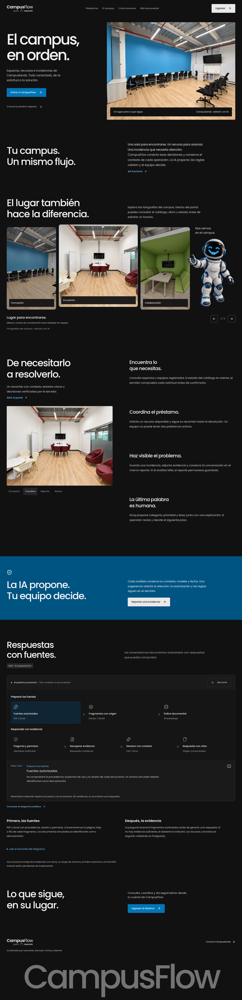

## Problema e impacto esperado

Coordinar salas, préstamos y reportes en herramientas separadas dificulta conocer la disponibilidad y reconstruir qué ocurrió. CampusFlow reúne esos recorridos y conserva trazabilidad de las operaciones.

| Necesidad | Respuesta del producto | Cómo evaluar el impacto |
|---|---|---|
| Evitar asignaciones imposibles | Estado, aforo y solapes validados en transacción | Intentos inválidos rechazados y conflictos bajo concurrencia |
| Controlar equipos prestados | Código único, préstamo activo y devolución | Equipos pendientes de devolución y movimientos auditados |
| Atender incidencias con contexto | Triaje estructurado y revisión humana | Tiempo hasta clasificación y resolución, medido en un piloto |
| Entender la agenda | Tablero gráfico con procedencia y advertencias | Bloques revisados y vinculados a espacios reales |
| Coordinar solicitudes inter-área | Canales temáticos por área, avisos oficiales y menciones con alertas en vivo | Tiempo de respuesta y resolución de solicitudes entre áreas operativas |
| Explicar las decisiones | Historial legible y evidencia de IA | Operaciones con registro y capacidad de reconstrucción |

No se han medido todavía ahorros de tiempo, tasas de resolución ni mejoras porcentuales. Los contadores del dashboard describen los registros cargados y su alcance visible.

## Agenda y automatización n8n

En el dashboard, **Gestión → Asistente de agenda** permite a ADMIN/OPERATOR describir una solicitud, pedir una propuesta y revisar la decisión. La aplicación de cambios exige configuración del servidor y confirmación explícita. El flujo importable usa Groq con respaldo Gemini y reglas auditadas de PostgreSQL. [Configurar y verificar n8n](docs/n8n/README.md).

La interfaz está integrada; en esta sesión no hay instancia n8n local disponible para acreditar el servicio real. Un resultado incierto exige revisar el estado antes de repetir la operación. RAG documental sigue en preparación.

## Interfaz y evidencia visual

| Acceso de escritorio | Acceso móvil |
|---|---|
| 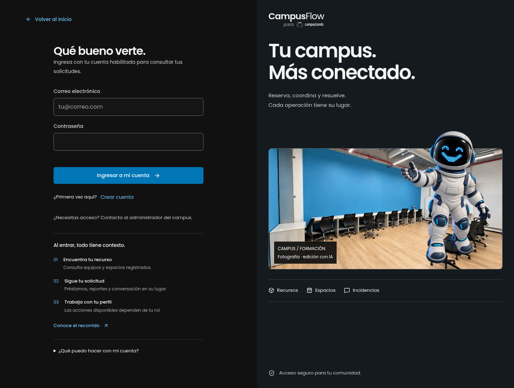 | 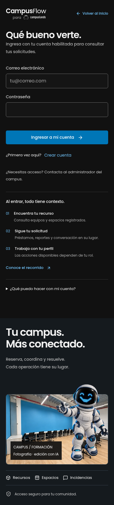 |

<details>
<summary>Ver dashboard, reservas, incidencias, historial y planos</summary>

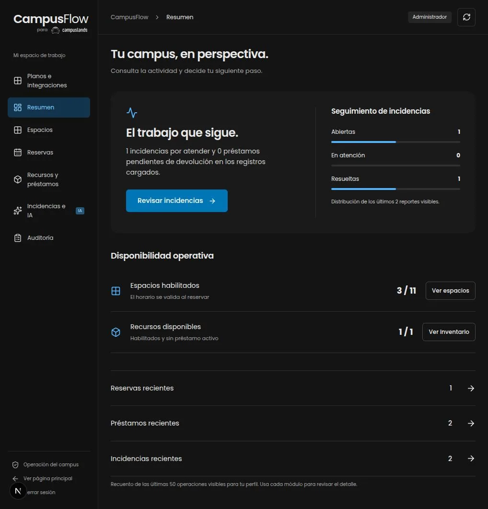
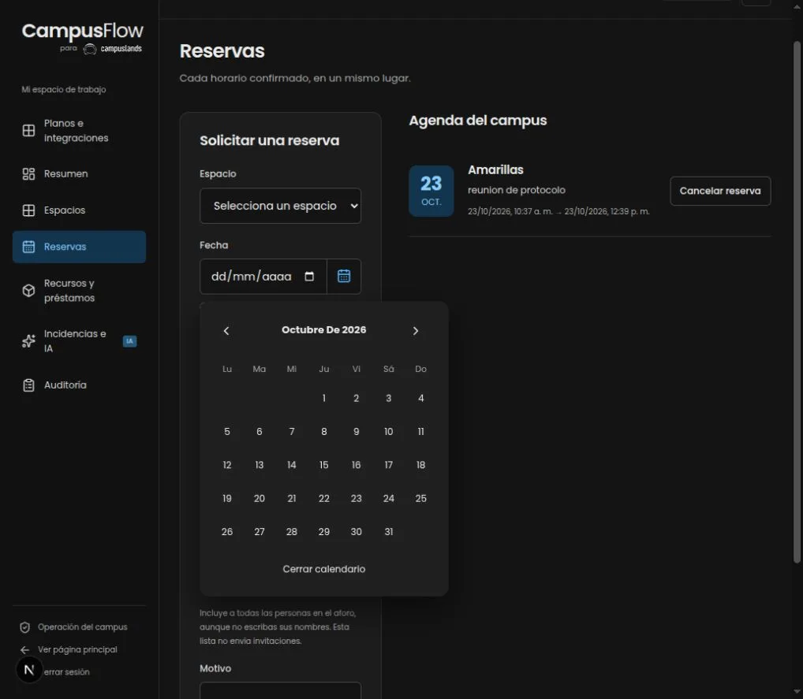
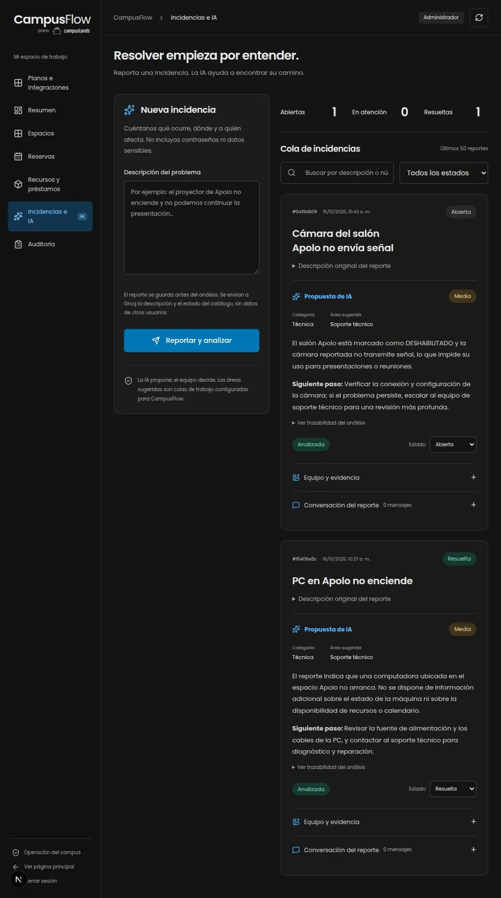
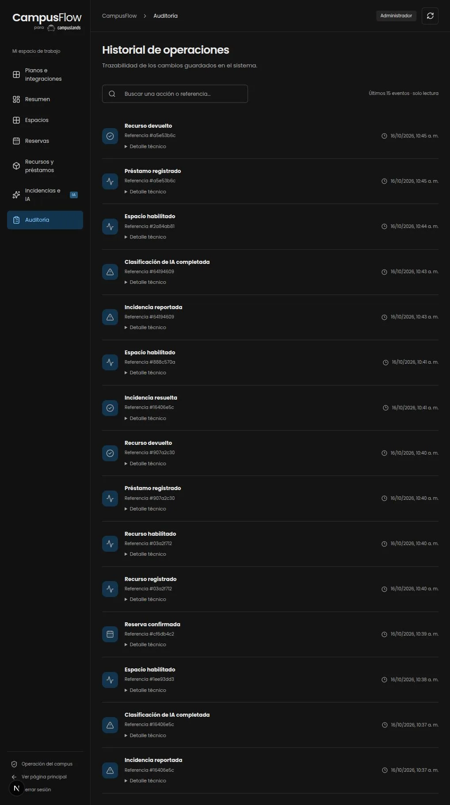
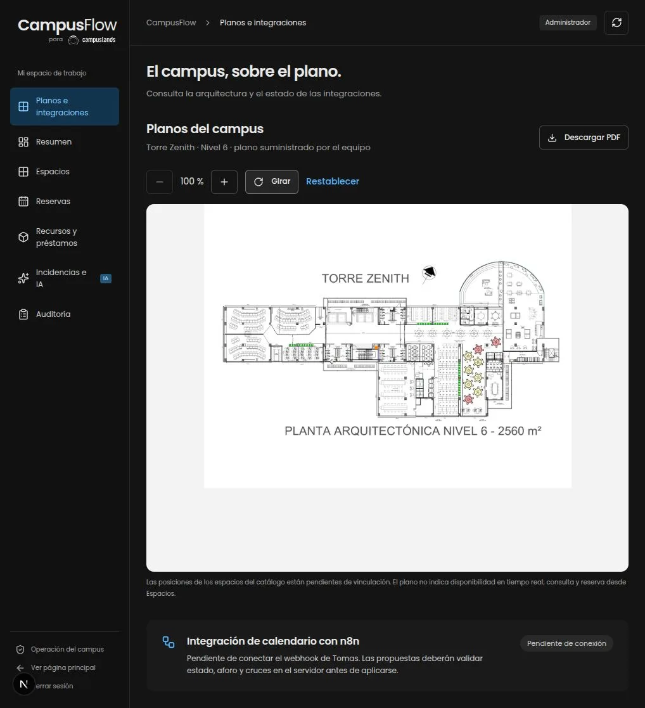

Estas cinco capturas proceden de la revisión autenticada del prototipo, previa a incorporar la navegación de horarios. Portada y login se recapturaron con Playwright CLI sobre la compilación local. No se publican cookies, sesiones ni credenciales. [Procedencia y comandos](docs/assets/README.md).

</details>

## Tecnologías utilizadas

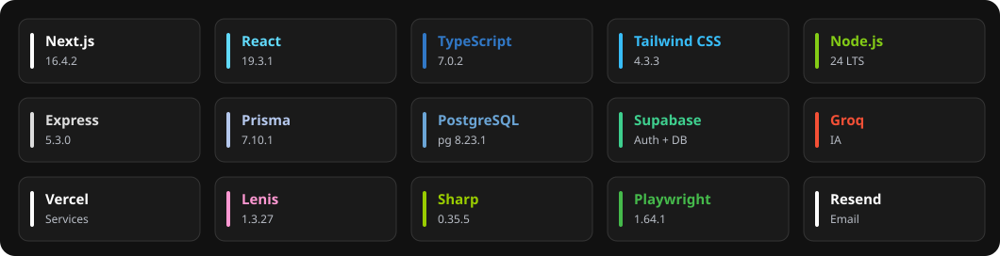

| Capa | Implementación |
|---|---|
| Web | Next.js 16.4.2, React 19.3.1, TypeScript 7.0.2, Tailwind CSS 4.3.3 |
| Interacción | Lenis 1.3.27 en portada, Lucide, Poppins local; scroll nativo en dashboard |
| API | Node.js 24, Express 5.3.0, Zod 4.6.7, Helmet y límites por usuario |
| Tiempo real | WebSocket nativo (ws 8.19), presencia y menciones dirigidas |
| Persistencia | PostgreSQL en Supabase, Prisma y adapter 7.10.1, pg 8.23.1 |
| Identidad | Supabase Auth; roles y propiedad comprobados por Express |
| IA | Groq para triaje textual y adaptador visual con salida validada |
| Evidencia y correo | Sharp 0.35.5; Resend vía HTTP desde servidor |
| Publicación | Vercel Services: frontend Next.js y backend Express |
| Calidad | Biome 2.5.15, pruebas Node/tsx, Playwright Test 1.64.1 y CLI 0.1.22 |

Versiones exactas y árbol reproducible en `package-lock.json`. La referencia visual de Astro/GSAP no implica que esas tecnologías estén instaladas: este producto conserva Next.js/Express.

## Arquitectura

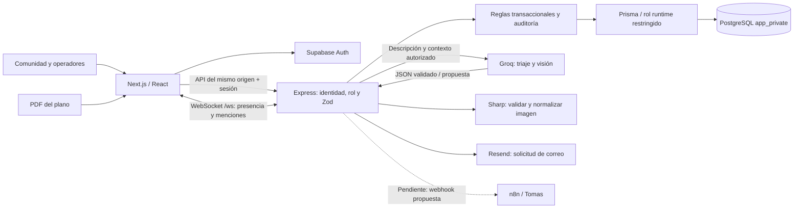

El navegador no recibe claves de Groq, correo ni credenciales PostgreSQL. Supabase autentica; Express aplica autorización y reglas. El rol de conexión a PostgreSQL está restringido: no se presupone aislamiento por usuario únicamente por usar Prisma o RLS.

La IA propone categoría, prioridad, área y siguiente paso. No habilita equipos, no certifica su funcionamiento mediante una foto y no cambia reservas por su cuenta.

### Modelo de datos

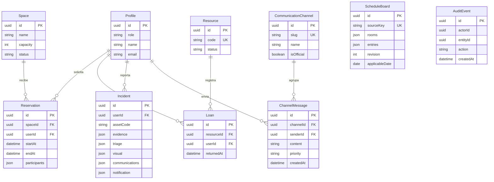

`ScheduleBoard` guarda una plantilla versionada en JSON; no equivale a reservas confirmadas. `AuditEvent.actorId/entityId` y `Incident.assetCode` son referencias verificadas por aplicación donde corresponde, no relaciones FK declaradas en Prisma. La evidencia fotográfica normalizada se guarda actualmente como JSON privado; para escalar conviene migrar a almacenamiento privado con URLs autorizadas.

### Regla central integrada

1. **Espacios:** solo habilitados, aforo suficiente y rango válido. Bloqueo de fila y exclusión GiST evitan cruces de reservas activas; intervalos `[inicio, fin)` permiten reservas contiguas.
2. **Recursos:** solo disponibles; bloqueo e índice único parcial impiden dos préstamos activos del mismo equipo.
3. **Incidencias:** identidad y acceso por propietario/rol, persistencia anterior al análisis, esquema de IA validado y cambios auditados. La propuesta se revisa antes de actuar.

Fechas persistidas en UTC/timestamptz y mostradas en `America/Bogota`. Un fallo del proveedor de IA conserva el reporte y permite reintentar.

### Flujo de incidencias y evidencia

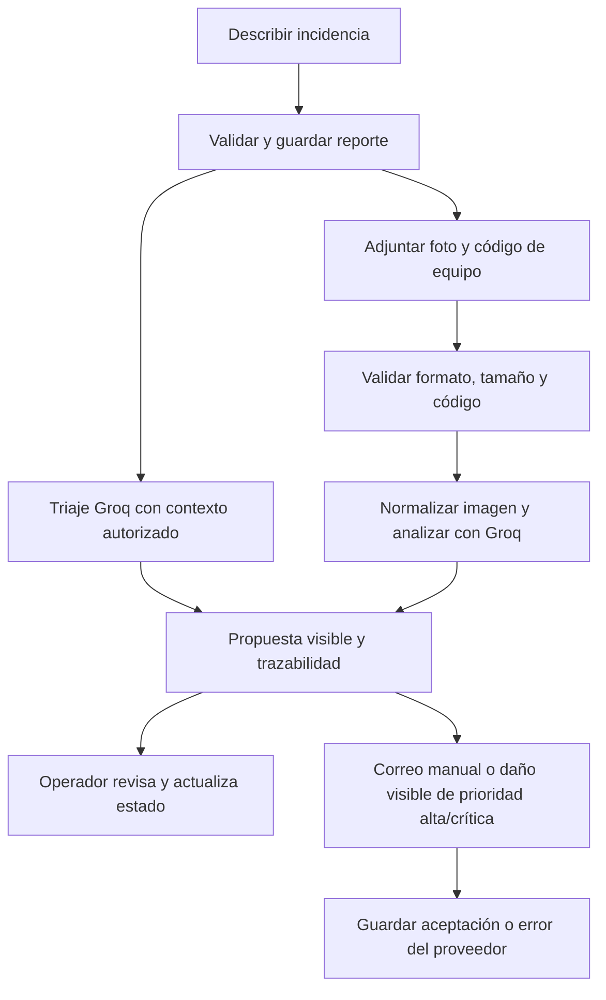

Una foto por incidencia, JPEG/PNG/WebP hasta 1 MB y 12 MP; se elimina EXIF y se normaliza. Un análisis visual puede declarar que no es posible determinar el estado. La conversación se persiste y se refresca manualmente; todavía no es chat en tiempo real. `ACCEPTED` en correo significa aceptación de Resend, no entrega al buzón.

## Estado real y pendientes

| Área | Estado y límite |
|---|---|
| Auth y permisos | Integración Supabase y roles por área (`ADMIN`, `FORMACION`, `COWORKING`, `MARKETING`, `SOPORTE`, `FULL_SERVICE`, `CLONAI`); cuentas simuladas y panel de reasignación |
| Tiempo real y coordinación | Motor WebSocket nativo (`/ws`) probado con presencia, 7 canales temáticos y menciones (`@usuario:Nombre`) con notificaciones en vivo |
| Reservas y préstamos | Persistencia, validaciones y concurrencia probadas con PostgreSQL aislado |
| Triaje textual | Groq conectado; contexto acotado sin datos de otros usuarios; fallos recuperables |
| Visión | Adaptador y pruebas con proveedor simulado; modelo listado por Groq. Falta acreditar una inferencia visual real de extremo a extremo |
| Planos | PDF y vista gráfica de Torre Zenith nivel 6. Falta vincular salas y equipos a coordenadas verificadas |
| Horarios | 24 bloques y 9 columnas importados a Supabase; tablero, filtros y edición con revisión optimista |
| Agenda fuente | Sin fecha/recurrencia confirmada ni equivalencias de salas; no genera reservas automáticamente |
| Correo | Resend conectado a Vercel; falta verificar dominio propio y entrega real. No se compró ni verificó campusflow.com |
| n8n | Rama de Tomas integrada: asistente, workflow y SQL sobre app_private. Migraciones aplicadas; webhook/credenciales aún pendientes. Ejecución externa real no acreditada |
| RAG PDF/Excel | Explicación visual en portada y plan técnico. Ingesta, embeddings, recuperación y chatbot pendientes |
| Escalado | Faltan paginación completa, rate limit distribuido, outbox durable, carga y métricas de piloto |

La imagen de horarios aportada no especifica día. Se conserva como plantilla sin fecha, con Grupo 11 cancelado y advertencias para rangos de Software inferidos visualmente. Los nombres de columnas y ubicaciones escritas presentan diferencias: deben revisarse antes de asignar espacios. [Detalle del prototipo](docs/prototype-status.md).

## Organización del repositorio

```text
apps/
  api/
    prisma/              # Esquema y migraciones aditivas
    scripts/             # Importaciones idempotentes
    src/ai/              # Contexto, triaje y visión
    src/integrations/    # n8n y correo
    src/                 # Auth, operaciones, evidencia, horarios
    tests/               # Reglas y API con PostgreSQL aislado
  web/
    public/brand/        # Marca y robot aportado
    public/plans/        # PDF y vista del plano
    src/components/      # Dashboard, calendario, horarios y seguimiento
    src/lib/             # Clientes y utilidades
    src/app/             # Portada, login y portal
 data/                   # Catálogo y fuente estructurada de horarios
 docs/                   # Arquitectura, contratos, rúbrica y relevo
 tests/e2e/              # Recorridos Playwright
```

## Instalación y entorno

Requisitos: Node 24 y npm 11 según `.nvmrc`/`packageManager`, PostgreSQL con permisos separados de migración y runtime, proyecto Supabase Auth y clave Groq de servidor si se ejecutará IA.

```bash
git clone https://github.com/DEIMER-PY/campusflow.git
cd campusflow
git switch feature/prototype-plans-vision
npm ci
cp apps/api/.env.example apps/api/.env
cp apps/web/.env.example apps/web/.env.local
npm run db:generate
```

Completar las variables en archivos ignorados. Solicitar acceso al propietario por un canal seguro; no pegar secretos en issues, chats o README.

| Variable | Uso |
|---|---|
| `DATABASE_URL` | Conexión del rol runtime restringido, solo API |
| `DIRECT_URL` | Conexión autorizada para migraciones; nunca navegador |
| `DATABASE_SSL_CA_FILE` o `DATABASE_SSL_CA_CERT` | CA pública para TLS verificado, path local o PEM en hosting |
| `SUPABASE_URL`, `SUPABASE_PUBLISHABLE_KEY` | Verificación de identidad desde API |
| `NEXT_PUBLIC_SUPABASE_URL`, `NEXT_PUBLIC_SUPABASE_PUBLISHABLE_KEY` | Configuración pública del cliente Auth |
| `API_URL` | Destino interno del proxy Next en local |
| `GROQ_API_KEY`, `GROQ_MODEL`, `GROQ_VISION_MODEL` | Inferencia de servidor |
| `RESEND_API_KEY`, `EMAIL_FROM`, `NOTIFICATION_RECIPIENT` | Correo de servidor con destinatario fijo |
| `N8N_WEBHOOK_URL`, `N8N_WEBHOOK_SECRET`, `N8N_MODE` | Solo al acordar contrato real con Tomas |

Para **una base nueva autorizada**, aplicar migraciones y configurar el rol/trigger documentados en [SQL runtime/Auth](docs/sql/runtime-and-auth.sql). No resetear el proyecto compartido ni ejecutar las integraciones de prueba contra producción.

```bash
npm run db:deploy
npm run db:import-spaces -w @campusflow/api
npm run db:import-schedule -w @campusflow/api
npm run dev
```

Valores locales de ejemplo: web `http://127.0.0.1:3000`, API `http://127.0.0.1:4000`; mantener `WEB_ORIGIN`, `API_URL` y el puerto alineados. En la copia de prototipo se utilizaron 3100/4100 para no interferir con otra sesión. Configurar Site URL y callback permitido `/auth/callback` en Supabase. El alta pública nunca concede ADMIN; la promoción requiere operación administrativa autorizada.

## Verificación y capturas

```bash
npm run lint
npm run typecheck
npm test
npm run build
# Solo contra PostgreSQL aislado, migrado y descartable:
npm run test:integration
# Configuración E2E incluida utiliza web 3000 / API 4000:
npm run test:e2e
```

`TEST_DATABASE_URL` debe apuntar a una base de pruebas separada. Las integraciones usan dobles de identidad y proveedores: acreditan reglas/API/persistencia, no una entrega real de correo o una inferencia visual real. En la comprobación más reciente pasaron `npm run check` (incluye 16 pruebas unitarias), dos pruebas de integración con PostgreSQL y 10 pruebas Playwright en escritorio/móvil; 2 casos sin configuración se omitieron localmente. Lint informa 100 avisos, sin errores: no equivale a ausencia de deuda técnica. Windows/macOS tienen jobs de CI añadidos, pendientes de resultado. Ver [plan de pruebas](docs/TESTING.md).

Capturas públicas reproducibles con Playwright CLI (primero iniciar la web):

```bash
npm exec playwright-cli -- -s=readme open http://127.0.0.1:3000/
npm exec playwright-cli -- -s=readme resize 1440 960
npm exec playwright-cli -- -s=readme screenshot --filename=docs/assets/screenshots/landing-redesign-desktop.webp
npm exec playwright-cli -- -s=readme goto http://127.0.0.1:3000/login
npm exec playwright-cli -- -s=readme screenshot --filename=docs/assets/screenshots/login-redesign-desktop.webp
npm exec playwright-cli -- -s=readme resize 390 844
npm exec playwright-cli -- -s=readme screenshot --filename=docs/assets/screenshots/login-redesign-mobile.webp
npm exec playwright-cli -- -s=readme close
```

No guardar estado de sesión ni introducir contraseñas en comandos versionados. [Registro de evidencia](docs/verification.md).

## Despliegue

[CampusFlow en Vercel](https://campusflow-prototype.vercel.app) usa `vercel.json` con dos Services: Next.js y Express, rutas `/api`, `/health` y `/ready` al backend. `/health` comprueba proceso; `/ready` comprueba conexión a datos. Último despliegue comprobado: `/ready` respondió `ready`.

La configuración conserva `outputDirectory: "."` en Express para evitar un fallo de empaquetado ESM observado con Services. Las variables sensibles se gestionan en Vercel, no en Git. El proyecto se publicó desde la copia local; no se presupone autodeploy por cada push. Validar build y entorno antes de promover otra versión.

## Neural Routing — nuestro equipo

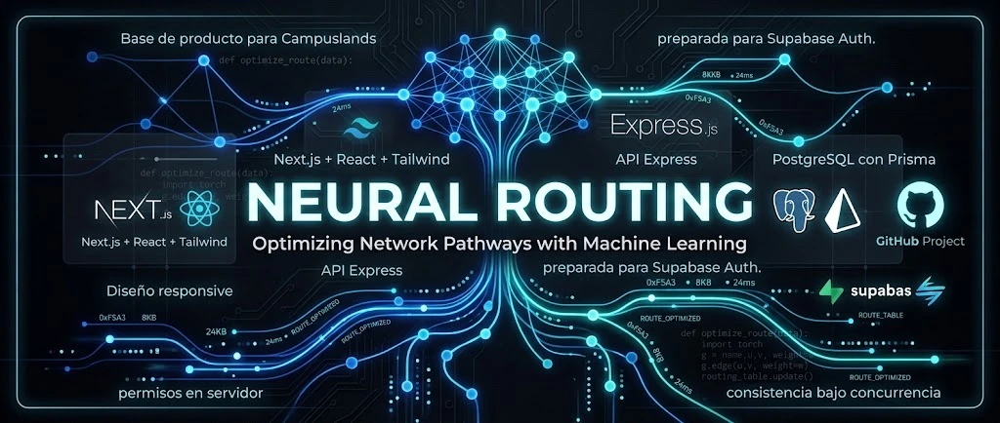

Somos **Neural Routing**, un equipo de cuatro desarrolladores que construye CampusFlow para conectar solicitudes, disponibilidad y atención dentro de Campuslands. Combinamos experiencia de usuario, reglas de negocio e inteligencia artificial para que cada decisión tenga contexto y pueda seguirse hasta su resultado.

Nuestro principio de trabajo: **la IA propone, las reglas validan y el equipo decide**. Trabajamos con responsabilidades claras, contratos compartidos y evidencia de pruebas; cada integrante debe poder explicar y defender el funcionamiento del producto.

La imagen es una pieza de presentación aportada por el usuario. Su lema sobre redes y machine learning es conceptual: CampusFlow no implementa entrenamiento propio ni optimización de redes de telecomunicaciones. El alcance técnico vigente se describe en este README.

### Integrantes y trabajo en GitHub

| Integrante | Usuario | Responsabilidad acordada |
|---|---|---|
| Deimer | [DEIMER-PY](https://github.com/DEIMER-PY) | Integración, API, Auth, IA y documentación |
| Leonardo | [Leonardo4516](https://github.com/Leonardo4516) | Continuación frontend, planos e integraciones |
| Samuel | [SamuelJoseMantilla](https://github.com/SamuelJoseMantilla) | UX/UI, responsive y frontend |
| Tomas | [TEstebanGQ](https://github.com/TEstebanGQ) | Espacios/reservas y flujos n8n |

Rama compartida de este prototipo: **`feature/prototype-plans-vision`**. Base de integración: **`develop`**. Cada compañero crea su feature desde la base acordada; para continuar este incremento:

```bash
git fetch origin
git switch -c feature/tu-tarea origin/feature/prototype-plans-vision
```

PR revisado hacia `develop`, sin force push ni mezclas automáticas. Commits convencionales con emoji: `feat(web): ✨ ...`, `fix(api): 🐛 ...`, `docs: 📝 ...`, `test: ✅ ...`. Coordinar cambios de `package-lock.json`, esquema Prisma y contratos antes de editar en paralelo. No fabricar autoría ni commits retroactivos.

## Rúbrica, defensa y próximos pasos

| Criterio | Evidencia y trabajo restante |
|---|---|
| Reglas y datos · 25 pts | Tres validaciones de dominio, transacciones y pruebas concurrentes. Confirmar dataset y equivalencias de horarios |
| IA estratégica · 20 pts | Triaje estructurado y trazable. Acreditar visión real; RAG sigue pendiente |
| MVP y UX/UI · 15 pts | Recorridos operativos, estados y errores. Repetir demo completa por rol en despliegue |
| Código y repositorio · 10 pts | Módulos, lockfile, historial y documentación. Revisar PR y CI antes de integrar |
| Cambio en vivo · 15 pts | Practicar modificación de una regla y sus casos válidos/inválidos en menos de tres minutos |
| Defensa y pitch · 15 pts | Explicar arquitectura, límites y aportes de los cuatro; usar [guion de práctica](docs/pitch-rehearsal.md) |

Esta tabla no asigna una calificación. [Auditoría detallada](docs/rubric-audit.md), [flujo de decisiones](docs/decision-flow.md), [contrato n8n](docs/n8n-integration.md), [plan RAG PDF/Excel](docs/rag-ingestion-plan.md) y [relevo actualizado](docs/LEONARDO_HANDOFF.md).

Prioridades: revisar agenda y datos con el equipo; configurar y probar el webhook de Tomas en modo propuesta; probar evidencia visual y correo reales; cerrar ingesta RAG con fuentes/permisos si el alcance lo permite; ensayar demo y cambio en vivo.

Los activos Campuslands y el plano fueron aportados como referencias por el usuario. No implican afiliación o autorización de marca adicional. El SVG del stack incorpora iconos de Simple Icons con revisión y procedencia guardadas en docs/assets/technologies/logos/provenance.json; Groq, Lenis y Playwright conservan representación tipográfica porque no estaban disponibles en esa fuente. Las marcas pertenecen a sus respectivos titulares. La imagen RAG generada tiene [procedencia documentada](docs/rag-image-provenance.json).


La integración de Tomas incluye [asistente y workflow](docs/n8n/README.md) y [puesta en marcha en otro equipo](docs/n8n/USO_EN_OTRO_EQUIPO.md). La configuración del webhook es solo servidor; no enviar secretos al navegador. El tablero del asistente se basa en las reservas cargadas: no acredita una consulta exhaustiva si hay más de 50 registros visibles.
