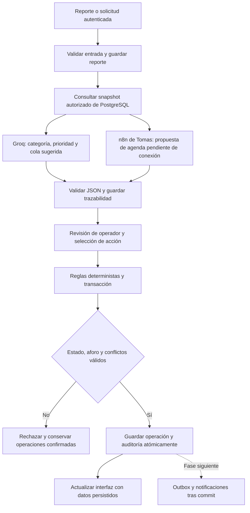

# Flujo operativo mejorado

El diagrama del equipo mezcla inferencia, comprobación matemática y ejecución. CampusFlow separa esas responsabilidades para que una propuesta de IA no autorice estados inválidos.

El triaje actual usa un snapshot acotado de recursos y espacios, sin usuarios ni reservas ajenas. Se registra la fecha de consulta y los límites. No es un canal realtime. El calendario completo y las propuestas n8n están pendientes de integrar con Tomas.

La precedencia protege reservas ya confirmadas, no una extensión que llega después. Entre solicitudes concurrentes PostgreSQL resuelve la exclusión; no se afirma FIFO estricto sin una cola persistida. El cálculo de alternativas puede buscar intervalos compatibles, pero no existe todavía un optimizador global ni una garantía matemática de calendario óptimo. Esas afirmaciones del esquema original deben retirarse del pitch.

Catálogo actualizado del contrato: 11 espacios. La respuesta ejemplo n8n es ilustrativa y no se carga como ocupación real. La IA no presta, no habilita recursos ni envía notificaciones por sí sola.
