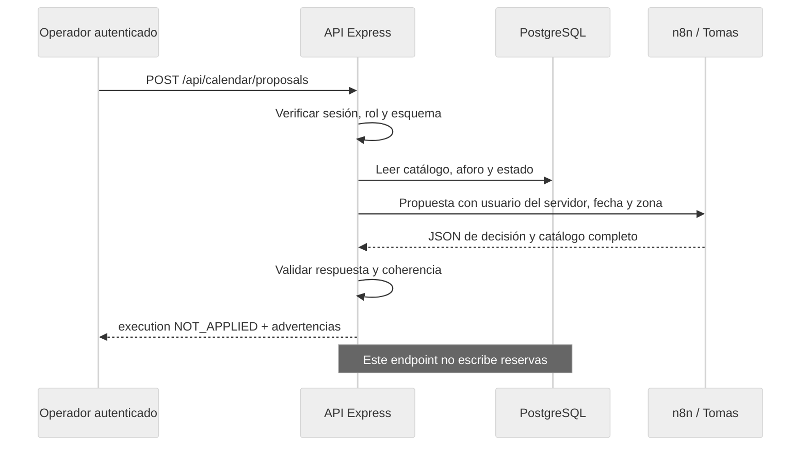

> Estado vigente (19 octubre 2026): asistente ADMIN/OPERATOR integrado desde `develop c179d63`, con Groq principal y Gemini de respaldo. La UI llama a Express con sesión; propuesta y ejecución tienen estados separados. Ver [guía del workflow](n8n/README.md). No hay n8n local disponible en esta sesión: configuración y ejecución real siguen pendientes de comprobación. El contrato histórico de propuesta de calendario que sigue abajo no implica que Express aplique el plan del asistente.

# Integración de Tomas con n8n

Fuente: CONTRATO_N8N_FRONTEND.md suministrado por el usuario. Se conserva como formato de intercambio, no como prueba de que el webhook exista o haya ejecutado cambios.

## Límite de confianza

Navegador autenticado usa Express /api/calendar/proposals. La URL y credencial del webhook permanecen en N8N_WEBHOOK_URL/N8N_WEBHOOK_SECRET del servidor, sin NEXT_PUBLIC. ADMIN/OPERATOR pueden pedir propuestas. DOCENTE/COMERCIAL/ADMINISTRATIVO describen tipo de solicitud y no conceden privilegios; usuario sale del UUID verificado por el servidor. No aceptar usuario ni rol de autorización del body.

Adaptador implementado con timeout, sin redirecciones, validación Zod del request y JSON completo de respuesta. Rechaza horas inválidas, duplicados, aforos distintos del catálogo, salas desconocidas y reportes incoherentes. Devuelve execution=NOT_APPLIED y advertencias si n8n propone una sala inhabilitada. N8N_MODE=proposal habilita el envío solo cuando Tomas confirme modo PROPUESTA sin efectos laterales. Sin URL/configuración falla explícitamente, sin respuesta ficticia.

## Contrato que falta acordar

Entrada del documento se mantiene en español. Añadir fecha YYYY-MM-DD (obligatoria para el adaptador), zonaHoraria America/Bogota y modo PROPUESTA: HH:mm sin fecha no identifica un intervalo real. El servidor añade X-Request-Id y X-CampusFlow-Mode=proposal. URL de producción o /webhook-test debe especificarse junto con la persistencia y la autenticación del flujo. Las extensiones de entrada se deben aceptar por Tomas antes de activar.

Salida esperada: status, decisionIA, salas e incidenciaDetectada del documento. La API trata accionEjecutada como texto del proveedor, no confirmación de commit. No publicar «reubicado» o «conflicto resuelto» como estado real por recibir HTTP 200. La UI operativa sigue leyendo PostgreSQL y la integración de agenda pendiente no sustituye esos datos por el array del webhook.

## Reglas de aceptación conjuntas

1. Las reservas confirmadas mantienen precedencia. Una extensión no desplaza a quien ya tiene el siguiente turno reservado. FIFO debe referirse a un orden persistido, no a la hora en que respondió la IA.
2. n8n puede clasificar/proponer alternativas. La ejecución usa el mismo servicio transaccional de CampusFlow: bloqueo de espacio/recurso, habilitación, aforo y solapes, comprobados nuevamente al confirmar. Sin bypass por escritura directa a tablas.
3. Reasignación necesita fecha, IDs estables, versión esperada e idempotency key. Registrar operación y auditoría en una transacción. Si usa otra BD o memoria, queda una integración pendiente y no se certifica la regla unificada.
4. Notificaciones solo después del commit y con evento/outbox reintentable. Existe adaptador de correo Resend para incidencias, sin entrega real acreditada ni outbox durable; las notificaciones de agenda y realtime siguen pendientes.
5. n8n nunca recibe claves Supabase/Groq del navegador. Error/timeout o esquema inválido no alteran operaciones existentes.
6. Demostrar con webhook real al menos una propuesta válida, aforo excedido, sala en mantenimiento, choque de horarios y respuesta inválida. Las pruebas del adaptador con dobles no cuentan como ejecución real de n8n.

Estado actual: adaptador y validación preparados y probados con fixtures. Faltan webhook, confirmar propuesta sin efectos, persistencia compartida, conexión del asistente y prueba extremo a extremo con Tomas. Groq del módulo 3 funciona independientemente; evitar clasificar el mismo reporte dos veces sin definir dueño de cada decisión.

## Recorrido acordado y activación

Antes de activar, Tomas debe entregar URL HTTPS de producción (sin secretos en Git), método de autenticación por canal seguro, confirmación de que el workflow no muta datos y ejemplo real compatible. Usar el secreto del servidor si el webhook exige Bearer; no incluir credenciales en la URL. Un webhook de prueba necesita estar escuchando y no sustituye el de producción.

Definir N8N_WEBHOOK_URL y N8N_MODE=proposal solo después de acordarlo. Configuración ausente o modo distinto falla sin llamar al proveedor. URL inválida devuelve N8N_INVALID_CONFIG; red/timeout N8N_UNAVAILABLE; HTTP no exitoso N8N_PROVIDER_ERROR; JSON/catálogo incoherente N8N_INVALID_RESPONSE. La API devuelve 503 salvo respuesta inválida (502); rol no operativo 403 e incompatibilidad inicial de estado/aforo 409.

### Matriz de prueba conjunta

| Caso | Evidencia esperada |
|---|---|
| Sin configuración | 503, sin reserva ni llamada ficticia |
| CLIENT o rol forjado en body | 403 o entrada rechazada; no privilegios nuevos |
| Espacio inhabilitado / aforo excedido | 409 antes de invocar n8n |
| Propuesta válida | 200, requestId, receivedAt, execution NOT_APPLIED |
| Sala duplicada/desconocida o capacidad alterada | 502 y ninguna reserva cambiada |
| Timeout / error proveedor | 503 recuperable, operaciones anteriores conservadas |
| Propuesta de sala inhabilitada | Advertencia; no asignación automática |
| Choque con reserva confirmada | Confirmación posterior rechazada por servicio transaccional; no desplazar terceros |
| Reasignación futura | Requiere contrato de ejecución con versión, idempotencia y auditoría; no implementado hoy |

Las pruebas unitarias actuales incluyen configuración, identidad derivada del servidor, URLs inválidas, red/HTTP/JSON y catálogo inconsistente. Usan un proveedor doble: no demuestran un workflow real. Para cierre registrar commit del adaptador, versión/export del workflow sin secretos, requestId, resultado y comparación antes/después de reservas. El equipo debe acordar qué campos personales pueden viajar; no ampliar el payload a participantes o correos sin autorización.

**Estado:** webhook todavía no suministrado. El tablero ScheduleBoard es gestión interna de la plantilla y no una interfaz conectada a n8n. No usarlo como evidencia de que Tomas ya integró su flujo.
