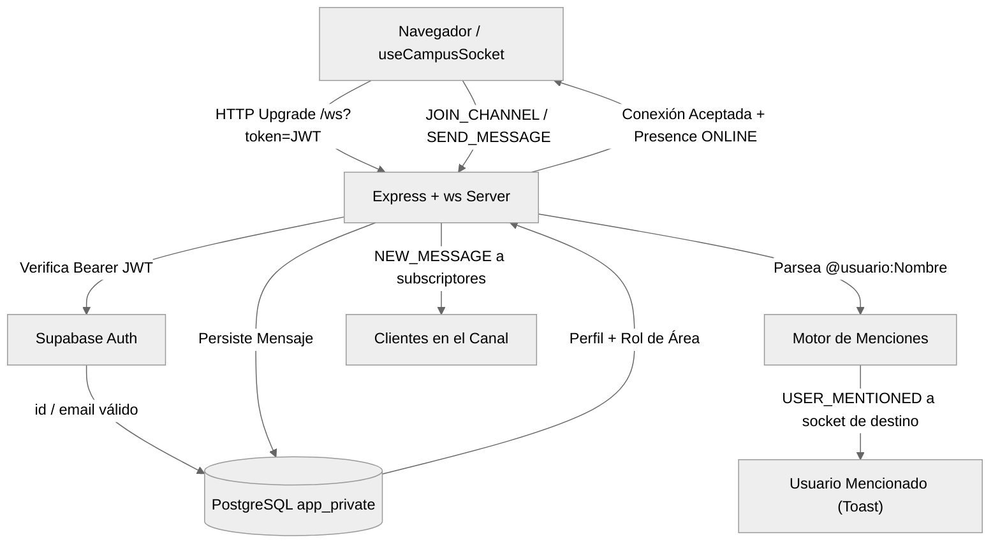

# Comunicaciones en Tiempo Real y Coordinación Inter-Áreas

**CampusFlow — Módulo de Coordinación Transversal y Avisos de Campus**

Este documento detalla la arquitectura, el protocolo WebSocket, el modelo de datos, la matriz de roles y el flujo de notificaciones implementados para la comunicación operativa entre áreas en Campuslands.

---

## 1. Filosofía y Alcance

Las comunicaciones en CampusFlow **no constituyen una red social abierta**, sino una herramienta operativa diseñada para:
1. **Fomentar la coordinación ágil entre áreas:** Si un área técnica (como *ClonAI*) requiere asistencia o préstamos urgentes de otra área (*Full Service* o *Soporte Técnico*), la solicitud se canaliza en tiempo real en los canales correspondientes sin fricciones de permisos rígidos.
2. **Canales temáticos por área y avisos generales:** Cada área cuenta con su canal especializado (`#formacion`, `#co-working`, `#marketing-alianzas`, `#soporte-tecnico`, `#full-service`, `#clonai`), mientras que `#avisos-generales` está reservado exclusivamente para comunicados oficiales de la administración (`ADMIN`).
3. **Menciones contextuales con notificación inmediata:** Soporte para etiquetar miembros del campus (`@usuario:Nombre`), espacios físicos (`@espacio:Nombre`) y recursos tecnológicos (`@equipo:Código`), alertando en vivo al usuario mencionado independientemente del canal en que se encuentre.

---

## 2. Arquitectura del Motor WebSocket

El sistema utiliza un servidor nativo de WebSockets (`ws`) montado directamente sobre el servidor HTTP de Express (`apps/api/src/index.ts`), compartiendo el mismo puerto (`4000`) y protegiendo el endpoint mediante un handshake seguro.



### 2.1. Handshake y Autenticación
- **Ruta:** `/ws?token=<SUPABASE_ACCESS_TOKEN>`
- **Validación:** Al recibir la solicitud de actualización HTTP (`upgrade`), el servidor extrae el token del query param o encabezado `Authorization`, lo valida contra `supabase.auth.getUser(token)` y carga el perfil del usuario desde `app_private.profiles`.
- **Cierre inmediato si inválido:** Si el token no es válido o el usuario carece de perfil activo, el socket se rechaza con código `1008` (Policy Violation) o `4401` (Unauthorized) antes de admitir cualquier evento.

### 2.2. Presencia y Heartbeat (Ping / Pong)
- El servidor mantiene un intervalo de latido cada 30 segundos (`ws.ping()`).
- Si un socket no responde con `pong` antes del siguiente ciclo, se asume desconexión forzada y se libera su registro de presencia.
- Al conectarse o desconectarse un usuario, se difunden los eventos `PRESENCE_STATE` y `USER_JOINED` / `USER_LEFT` con el recuento actualizado de miembros en línea por canal (`● N en línea`).

---

## 3. Matriz de Roles y Áreas

El enum `Role` en Prisma y PostgreSQL se estructuró en torno a las áreas operativas del campus:

| Rol | Área / Dominio | Permisos en Comunicaciones | Permisos de Gestión |
|---|---|---|---|
| `ADMIN` | Dirección General del Campus | Escribir en todos los canales (incluido `#avisos-generales`), emitir alertas `URGENT`, reasignar áreas de usuarios. | Acceso completo a auditoría, configuración, sobrecupos y todos los módulos. |
| `FORMACION` | Docentes, Coordinación Académica, Bootcamps | Escribir en canales operativos, mencionar miembros/aulas, solicitar recursos. | Solicitar y gestionar reservas académicas y reportar fallas en clases. |
| `COWORKING` | Áreas de Coworking, Invitados, Emprendedores | Escribir en canales operativos, solicitar soporte y salas de reuniones. | Reservar espacios de trabajo compartido y reportar incidencias. |
| `MARKETING` | Alianzas, Eventos, Difusión, Comercial | Escribir en canales operativos, solicitar auditorio y recursos audiovisuales. | Solicitud de espacios para eventos corporativos y alianzas externas. |
| `SOPORTE` | Soporte Técnico, Mantenimiento IT | Escribir en canales operativos, coordinar atención de fallas. | Triaje de incidencias, cambio de estado de equipos (disponible/mantenimiento). |
| `FULL_SERVICE` | Operaciones Generales, Logística, Mantenimiento | Escribir en canales operativos, coordinar logística y traslados. | Gestión de recursos físicos y adecuación de espacios. |
| `CLONAI` | Área de IA, Proyectos Especiales, I+D | Escribir en canales operativos, solicitar colaboración técnica y recursos. | Acceso a laboratorios especializados y solicitud de equipamiento. |
| `OPERATOR` | Operador general (legacy) | Igual que áreas operativas. | Operaciones de reservas y préstamos. |
| `CLIENT` | Usuario externo / estudiante (legacy) | Lectura general y participación acotada. | Consulta de reservas propias. |

---

## 4. Canales de Comunicación Preconfigurados

La base de datos contiene los siguientes canales inicializados mediante migración:

| Slug | Nombre | Descripción | Regla de Escritura |
|---|---|---|---|
| `avisos-generales` | `#avisos-generales` | Comunicados oficiales y anuncios de dirección. | **Solo ADMIN**. |
| `formacion` | `#formacion` | Coordinación de clases, bootcamps y profesores. | Abierto a todas las áreas. |
| `co-working` | `#co-working` | Espacios compartidos, convivencia y comunidad. | Abierto a todas las áreas. |
| `marketing-alianzas` | `#marketing-alianzas` | Alianzas externas, eventos especiales y visitas. | Abierto a todas las áreas. |
| `soporte-tecnico` | `#soporte-tecnico` | Solicitudes urgentes de soporte y fallas de hardware. | Abierto a todas las áreas. |
| `full-service` | `#full-service` | Servicios generales, logística y adecuaciones. | Abierto a todas las áreas. |
| `clonai` | `#clonai` | Proyectos de inteligencia artificial y tecnología avanzada. | Abierto a todas las áreas. |

---

## 5. Protocolo de Mensajes y Menciones

### 5.1. Esquema de Eventos WebSocket

#### Cliente → Servidor:
- **`JOIN_CHANNEL`**: `{ "type": "JOIN_CHANNEL", "channelSlug": "formacion" }`
- **`SEND_MESSAGE`**:
  ```json
  {
    "type": "SEND_MESSAGE",
    "channelSlug": "formacion",
    "content": "Hola @usuario:David Torres, ¿podemos revisar el proyector de @espacio:Apolo?",
    "priority": "NORMAL"
  }
  ```
  *(Prioridades permitidas: `NORMAL`, `URGENT` — `URGENT` requiere rol `ADMIN`)*.
- **`LEAVE_CHANNEL`**: `{ "type": "LEAVE_CHANNEL", "channelSlug": "formacion" }`

#### Servidor → Cliente:
- **`NEW_MESSAGE`**: Emite el mensaje persistido con los datos de autor y canal a todos los conectados al canal.
- **`USER_MENTIONED`**: Enviado en tiempo real a las conexiones activas del usuario mencionado:
  ```json
  {
    "type": "USER_MENTIONED",
    "channelSlug": "formacion",
    "channelName": "#formacion",
    "senderName": "Carlos Gómez",
    "senderArea": "FORMACION",
    "content": "Hola @usuario:David Torres, ¿podemos revisar el proyector de @espacio:Apolo?",
    "messageId": "uuid-...",
    "createdAt": "2026-10-23T14:15:00Z"
  }
  ```
- **`PRESENCE_STATE`**: Lista y conteo de miembros activos.
- **`ERROR`**: `{ "type": "ERROR", "message": "Solo el administrador puede publicar en este canal" }`

### 5.2. Sintaxis de Menciones Inteligentes

El analizador en servidor y cliente detecta expresiones con prefijo formal:
- **Miembros:** `@usuario:Nombre Apellido` (ej. `@usuario:David Torres`)
- **Espacios:** `@espacio:Nombre Espacio` (ej. `@espacio:Cosmos`, `@espacio:Apolo`)
- **Equipos:** `@equipo:Código` (ej. `@equipo:EQ-PRJ-01`)

En la interfaz web, escribir `@` despliega un menú contextual flotante con autocompletado en tres pestañas:
1. Miembros de la comunidad con su insignia de área coloreada.
2. Salas y espacios con su aforo y estado.
3. Equipos tecnológicos con su código y disponibilidad.

---

## 6. Endpoints REST Complementarios

Para cargar historiales y directorio sin sobrecargar el socket, la API expone:

| Método | Endpoint | Roles | Descripción |
|---|---|---|---|
| `GET` | `/api/channels` | Todos autenticados | Lista de canales disponibles con recuento de mensajes recientes. |
| `GET` | `/api/channels/:slug/messages` | Todos autenticados | Últimos 50 mensajes del canal, orden cronológico, con autor y rol. |
| `GET` | `/api/members` | Todos autenticados | Directorio de miembros registrados con su ID, nombre, email y área asignada. |
| `GET` | `/api/admin/users` | `ADMIN` | Lista completa de perfiles para gestión de accesos. |
| `PATCH` | `/api/admin/users/:id/role` | `ADMIN` | Reasigna el área operativa de un usuario (`role: "CLONAI"`). |

---

## 7. Cuentas de Prueba y Simulación

Se han provisto cuentas oficiales de prueba en Supabase Auth y PostgreSQL con la contraseña maestra unificada: `CampusFlow2026!`

| Área | Nombre Completo | Correo de Acceso | Rol Asignado |
|---|---|---|---|
| **Administración** | Leonardo (Admin) | `programador8903@gmail.com` | `ADMIN` |
| **Formación** | Prof. Carlos Gómez | `carlos.formacion@campuslands.com` | `FORMACION` |
| **Co-Working** | Ana Martínez | `ana.coworking@campuslands.com` | `COWORKING` |
| **Marketing** | Laura Rincón | `laura.marketing@campuslands.com` | `MARKETING` |
| **Soporte** | David Torres | `david.soporte@campuslands.com` | `SOPORTE` |
| **Full Service** | Marta Sánchez | `marta.operaciones@campuslands.com` | `FULL_SERVICE` |
| **ClonAI** | Felipe Morales | `felipe.clonai@campuslands.com` | `CLONAI` |

---

## 8. Verificación y Pruebas Automatizadas

El archivo de pruebas unitarias `apps/api/tests/realtime.test.ts` valida:
1. **Control de acceso en avisos:** Rechazo de publicaciones de usuarios no-admin en `#avisos-generales`.
2. **Coordinación transversal:** Validación de que cualquier área operativa puede interactuar en los canales departamentales.
3. **Extracción y normalización de menciones:** Regex parser que extrae de forma robusta nombres compuestos, nombres con espacios y etiquetas de activos sin truncarse por caracteres especiales.
4. **Validación de payloads:** Rechazo de mensajes vacíos, cadenas de solo espacios o valores de prioridad no reconocidos.

Para ejecutar la suite:
```bash
npm run test -w @campusflow/api
```
