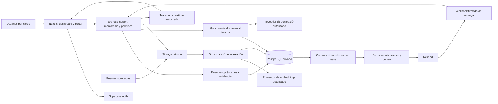
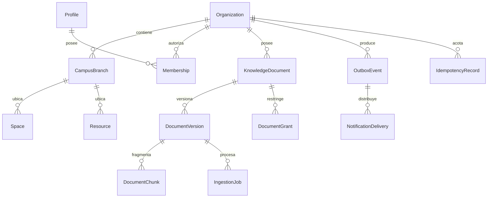

# Arquitectura propuesta, concurrencia y migraciones

**Diseño pendiente de implementación.** Partir de [la auditoría](current-state.md); conservar el monorepo y las reglas existentes. Go es un nuevo límite de servicio documental, no una reescritura de Express. Los diagramas muestran la arquitectura objetivo, salvo indicación.

## Arquitectura objetivo

Todos los componentes nuevos están propuestos. Express mantiene la identidad y el control de dominio; Go revalida acceso documental en cada consulta/trabajo. n8n no asume permisos de usuario por recibir un JSON. Los eventos salen de una transacción confirmada, no del navegador.

## SaaS: modelo de acceso

Separar **organización**, **sede**, **cargo/área** y **permiso**. Una misma persona puede pertenecer a varias instituciones con funciones distintas. Evitar convertir FORMACION/MARKETING/SOPORTE en una jerarquía global de administración. Los nombres actuales de áreas no constituyen un organigrama oficial confirmado.

Propuesta: `OrganizationMembership(userId, organizationId, role, status)` y permisos por acción como `reservation.read.own`, `reservation.read.branch`, `loan.return`, `incident.assign`, `knowledge.approve`, `audit.read.organization`. Área es un atributo de enrutamiento. Cada solicitud resuelve membresía activa desde la BD y valida sede/recurso; un selector de organización en la UI no otorga acceso.

| Contexto | Regla |
|---|---|
| Usuario común | Sus operaciones y documentos concedidos |
| Operador | Acciones operativas explícitas dentro de su sede |
| Administrador institucional | Configuración y auditoría de su organización |
| Administrador de plataforma futuro | Acceso excepcional registrado; no lectura transversal implícita |
| n8n / Go / trabajador | Identidad técnica propia, alcance mínimo por tarea y organización |

No aceptar `isSuperAdmin`, rol ni propietario del body. En la transición, roles no reconocidos conservan ámbito de propietario o son rechazados; nunca reciben `{}` como filtro. Las consultas Prisma privilegiadas requieren filtros efectivos: RLS no los sustituye. RLS adicional debe diseñarse según el rol runtime y probarse, no asumir `auth.uid()` disponible en una conexión de servidor.

## Esquema objetivo por etapas

Conservar `Profile`, `Space`, `Resource`, `Reservation`, `Loan`, `Incident`, `AuditEvent` y `ScheduleBoard`; no duplicarlos en un nuevo servicio. Añadir FKs compuestas donde proceda para impedir asociar una reserva de organización A a una sala de B. Documentos, archivos, mensajes, auditoría, trabajos e idempotencia también necesitan alcance institucional; añadir organizationId solo a Space no produce aislamiento SaaS.

## Plan de migración seguro

| Etapa | Cambio propuesto | Comprobación y recuperación |
|---|---|---|
| M0 | Inventariar drift realtime y comparar SQL/columnas/índices/grants con historial | Clon aislado y diff revisado; resolver historial solo tras demostrar equivalencia. No modificar checksums antiguos |
| M1 | Tablas outbox, entregas e idempotencia; índices para paginación | Aplicación anterior sigue funcionando; desactivar despachador conserva eventos pendientes |
| M2 | Storage privado y tabla de evidencia; migración incremental del JSON de imágenes | Backfill con hash/verificación, lectura compatible temporal; retirar JSON en otra entrega |
| M3 | Conocimiento/versiones/ACL/trabajos; extensión vector con credencial de migración | Validar modelo/dimensiones antes de definir columna. Servicio runtime no crea extensiones |
| M4 | Organizaciones/sedes/membresías y claves institucionales inicialmente compatibles | Backfill solo con mapeo aprobado de datos existentes; no inventar sedes o afiliaciones |
| M5 | Imponer NOT NULL/FKs/uniques y filtros institucionales tras backfill | Pruebas cruzadas HTTP/socket/RAG/correo; bloquear publicación si hay datos sin asignar |
| M6 | Normalizar conversación de incidencias y ubicaciones del plano | Leer ambos formatos durante transición; comparar recuentos; retirar compatibilidad en PR posterior |

Una sola autoridad genera migraciones: Prisma y SQL versionado revisados por Leonardo/Deimer. Go usa esos esquemas sin auto-migrar al arrancar. Crear/aplicar sobre BD aislada antes de revisión; las migraciones de producción las ejecuta un job de release con credencial separada. Conservar exclusión GiST y unicidad parcial: un diff ORM no debe eliminarlas. El rollback de código no deshace automáticamente el esquema; preferir correcciones aditivas y snapshot probado.

`prisma migrate deploy` aplica migraciones pendientes, pero **no detecta drift**; combinar inspección de catálogo, historial y diff conforme al CLI instalado. [Referencia Prisma v7](https://www.prisma.io/docs/orm/v7/reference/prisma-cli-reference).

## Concurrencia

| Riesgo | Cambio concreto | Prueba que lo acredita |
|---|---|---|
| Doble préstamo/reserva | Conservar bloqueo de activo, revalidación e índices de BD | 20 solicitudes simultáneas al mismo activo: una aceptada para intervalo incompatible; contiguas válidas |
| Repetir creación tras timeout | `IdempotencyRecord` único por organización, actor, ruta y clave; hash del request y respuesta persistida en transacción | Misma clave/payload retorna mismo resultado; clave con payload distinto devuelve conflicto; claves distintas conservan reglas |
| Acciones sobre varios activos | Orden determinista por UUID de locks; transacciones cortas | Dos reubicaciones con orden inverso no dejan estados parciales; reintento acotado solo ante errores recuperables |
| Edición simultánea | Reutilizar revisión optimista de ScheduleBoard; extender `version` a cambios que lo necesiten | Versión obsoleta devuelve 409 y permite recargar; no sobrescribe edición ajena |
| Evento/correo perdido | Evento y auditoría en la misma transacción que el cambio; trabajadores con lease | Caída después de commit y antes del envío no pierde evento |
| Trabajo repetido | Reclamo corto con `FOR UPDATE SKIP LOCKED`, lease recuperable, clave única por versión | Dos trabajadores no indexan ni despachan una versión simultáneamente |
| Abuso de IA | Rate limit compartido, límite por organización y semáforo de inferencia | Réplicas comparten cuota; 429 predecible; cola acotada sin crecimiento ilimitado |

No mantener una transacción abierta durante llamadas a Groq, embeddings, n8n o Resend. Para trabajos usar fase de reclamo, operación externa y fase de confirmación con fencing/versionado del lease. No prometer exactly-once entre PostgreSQL y un proveedor HTTP: combinar entrega al menos una vez, deduplicación y conciliación de resultados inciertos.

## Rendimiento

1. Paginar reservas, préstamos, incidencias y auditoría por cursor estable `(createdAt,id)`; mensajes por `(createdAt,id)` con navegación hacia atrás. Añadir filtros servidor y límites máximos. Evitar cargar todo para buscar en el navegador.
2. `GET /api/dashboard/summary` propuesto: agregados autorizados con periodo, zona, `asOf` y alcance. Distinguir registros cargados de total. No calcular ocupación sin fecha/agenda validadas.
3. Revisar `EXPLAIN (ANALYZE, BUFFERS)` solo sobre consultas y datos seguros de pruebas antes de crear índices. Candidatos: `(organizationId,userId,createdAt,id)` y `(organizationId,status,createdAt,id)` según acceso; índices cuestan escritura y almacenamiento.
4. Evidencias/fuentes en Storage privado; BD almacena referencia, tamaño y hash. URLs breves autorizadas; no incluir binarios en las listas.
5. Cargar módulos del dashboard al usarlos, dividir bundles pesados de planos/comunicaciones/RAG; mantener foco/estado al navegar. Virtualizar tablas solo si las mediciones lo requieren.
6. Cachear únicamente catálogos compatibles con permisos y versiones. Clave incluye organización, ámbito y versión; invalidar tras cambios. Sin caché compartida para respuestas privadas sin diseño de aislamiento.
7. Pool actual API: máximo 5 por proceso. Presupuestar `réplicas_API × pool_API + réplicas_Go × pool_Go + trabajadores + administración`, bajo el límite efectivo del proveedor; medir esperas. No aumentar pools para ocultar consultas lentas.

## Infraestructura y observabilidad

Mantener Vercel Services web/API y Supabase. Para Go evaluar un servicio/contenedor con ejecución durable y worker separado; elegir proveedor/coste tras prototipo, sin provisionarlo en este trabajo. n8n necesita persistencia de sus ejecuciones, credenciales gestionadas, workflow versionado y backup. Una URL localhost en el equipo de Tomas no es alcanzable desde Vercel.

La documentación actual de [Vercel WebSockets](https://vercel.com/docs/functions/websockets) sí admite conexiones en Functions con Fluid compute. Por tanto no se exige migrar hosting por una restricción histórica. **El código actual de la rama no está conectado a esa configuración:** monta ws en index.ts, mientras Vercel apunta a app.ts, y no hay rewrite `/ws` al backend. Probar entrypoint HTTP/export y ruta de upgrade; gestionar reconexión, duración y presencia/pubsub fuera de memoria para múltiples instancias. Mantener persistencia en BD, autorización por canal y recuperación REST.

Observabilidad propuesta: requestId/eventId/jobId enlazados, latencia p50/p95/p99, errores y conflictos 409, espera de pool/locks, tamaño/antigüedad de cola, reintentos, coste de IA y fallos de entrega por organización. Logs sin tokens, emails, documentos completos ni query strings sensibles. Alertar por readiness y eventos atascados; salud de proceso y disponibilidad externa siguen siendo señales distintas.

Prueba de carga aislada: rampas 1/10/25/50 clientes, operaciones de lectura y contención separadas, payloads representativos, recursos/coste registrados. Medir baseline antes de fijar SLO. Criterios iniciales propuestos: cero dobles préstamos/solapes, cero fuga institucional, cola recuperable y latencias sin degradación sostenida; los umbrales de tiempo deben acordarse después de medir.
