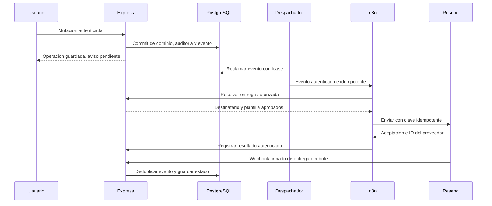

# Correos dentro del flujo de Tomas

**Contrato propuesto, pendiente de implementación y validación conjunta.** Hoy solo existe envío Resend de incidencias a un destinatario fijo de servidor, con estado en `Incident.notification`. No hay outbox ni webhook de entrega. Se conserva el mecanismo actual hasta migrar cada evento, evitando que Express y n8n envíen dos veces la misma notificación.

## Tres flujos de correo distintos

| Flujo | Responsable | Regla |
|---|---|---|
| Confirmación, recuperación y seguridad de sesión | Supabase Auth + SMTP autorizado; Deimer | Conservar tokens/enlaces de Auth; no recrearlos en prompts o workflows |
| Avisos operativos de reservas, préstamos e incidencias | n8n de Tomas consume eventos de dominio | Solo después del commit, destinatarios resueltos por servidor |
| Campañas o avisos comerciales futuros | Fuera del alcance operativo inmediato | Consentimiento/preferencias separados; no convertir contactos operativos en marketing |

## Flujo objetivo

La ruta de callback Resend se registra con cuerpo crudo **antes de** `express.json` y del middleware de sesión de usuarios, con verificación de firma/timestamp, límite de tamaño y deduplicación. No basta con recibir un `providerId` desde cualquier cliente. Ver [verificación oficial Resend](https://resend.com/docs/webhooks/verify-webhooks-requests).

## Eventos iniciales y público

| Evento propuesto | Origen confirmado | Destinatarios autorizados |
|---|---|---|
| `reservation.created` / `reservation.cancelled` | Transacción API o función n8n aprobada | Solicitante; responsables configurados de sede si corresponde |
| `reservation.relocated` | Operación aplicada y revalidada | Solicitante y afectados autorizados; no por una propuesta |
| `loan.created` / `loan.returned` | Servicio transaccional existente | Prestatario y cola operativa configurada |
| `incident.created` / `incident.status_changed` | Incidencia persistida | Reportante y responsables autorizados |
| `incident.triaged` | Resultado persistido y revisable | Cola correspondiente; no incluir imágenes por defecto |
| `knowledge.ingestion_completed` / `knowledge.ingestion_failed` | Trabajo Go finalizado | Cargador/aprobador dentro de su organización |
| Recordatorio de devolución o reserva | Job programado que reconsulta estado vigente | Solo si fecha/condición están modeladas y autorizadas |

`Loan` no tiene vencimiento hoy: primero añadir `dueAt` y política acordada antes de hablar de préstamos vencidos. El tablero ScheduleBoard sin fecha no origina recordatorios. Una propuesta n8n, error, rollback o respuesta APPLIED sin comprobación suficiente no genera confirmación de cambio.

## Contrato de evento y resultado

Campos del sobre v1: eventId UUID, eventType, schemaVersion, occurredAt UTC, organizationId cuando se habilite SaaS, aggregateType/aggregateId, aggregateVersion, actorId derivado del servidor, correlationId, deliveryId y templateKey/version. No enviar claves, tokens de sesión, PDF, fotos ni toda la descripción de una incidencia al workflow si basta una referencia.

Endpoints internos propuestos: resolver entrega, reclamar/reintentar y registrar aceptación/error mediante identidad técnica con scope. El evento contiene una referencia de destinatario; Express resuelve dirección desde identidad verificada o configuración institucional autorizada. No confiar en correo, UUID de usuario, rol u organización enviados por el navegador. Hoy Profile en develop no guarda email: no inventar que la dirección ya está disponible en el contrato; Deimer definirá resolución server-side y sincronización verificada.

Respuesta n8n: eventId, deliveryId, attemptId, status, providerId opcional y errorCode acotado. Un callback solo actualiza la entrega a la que corresponde y cuyo lease/version sigue vigente. La respuesta HTTP del workflow no basta para marcar la operación de dominio aplicada.

## Persistencia e idempotencia

`OutboxEvent`: id, tipo, esquema, agregado/versión, organización, payload mínimo, createdAt, availableAt, attempts, leaseOwner/expiry, estado. Índice para trabajos pendientes. `NotificationDelivery`: eventId, recipientReference, canal, templateVersion, providerId, estado, fechas y último código de error. Unique por `(eventId,recipientReference,channel,templateVersion)`; clave de proveedor basada en deliveryId, estable entre reintentos.

Estados de transporte: PENDING → SENDING → ACCEPTED; confirmación posterior DELIVERED/BOUNCED/COMPLAINED/FAILED, o UNKNOWN ante timeout de resultado incierto. Guardar eventos del proveedor de forma append-only y proyectar estado con reglas para callbacks repetidos/fuera de orden; una aceptación tardía no borra un rebote. [Eventos Resend](https://resend.com/docs/webhooks/event-types): delivered significa recepción por el servidor de correo del destinatario, no lectura humana ni bandeja principal.

Reintentos propuestos: backoff acotado con jitter para errores transitorios/429; dominio o dirección inválidos van a revisión. Configurar cantidad/tiempo máximo con cuota del proveedor. No reenviar indefinidamente: la ventana idempotente del proveedor es limitada; ante resultado incierto que la supere, conciliar o revisar manualmente antes de reenviar. Fallo de correo no revierte una reserva ya confirmada.

Tomas adapta los nodos transaccionales de agenda para emitir outbox junto al commit, coordinado con Leonardo; no añadir un nodo de correo previo a `APLICADA`. Un dispatcher puede llamar n8n y hacer polling de pendientes, pero no depender solo de un webhook efímero. Su proceso durable y scheduler se definen con Deimer.

## Implementación por integrante

- **Tomas:** workflow v1 importable sin secretos, credenciales n8n gestionadas, plantillas, reintentos, manejo de duplicados y callback a API; documentar URL HTTPS de producción y credenciales por canal seguro. Health local no cierra la integración.
- **Leonardo:** esquema outbox/entregas/leases, escritura atómica, consultas internas mínimas y pruebas de carreras/rollback.
- **Deimer:** autenticación de servicios, resolución de destinatarios, dominio/remitente, secretos, callback firmado y decisión de transición desde email.ts. Proveedor y DNS reales por operación autorizada.
- **Mantilla:** detalle de entrega, diferencia pendiente/aceptado/entregado/rebotado, reintento solo autorizado y explicación de operación guardada aunque el correo falle.

## Aceptación conjunta

Commit real → evento → n8n activo → aceptación → callback firmado → estado visible. Repetir evento y callback sin duplicar envío/registro; simular timeout después del envío; caída del dispatcher; rollback sin correo; firma falsa y replay rechazados; destinatario de otra organización inaccesible; propuesta n8n sin aviso de aplicación. Usar buzones de prueba autorizados y guardar IDs/estados sin direcciones ni contenido privado en Git. No habilitar execute, WhatsApp o login de BD por esta documentación.
