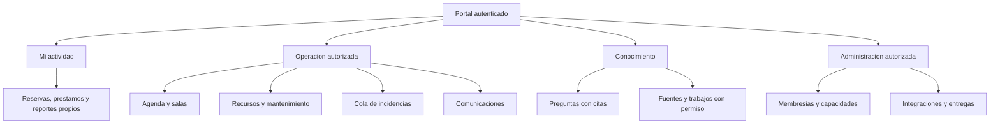

# Producto, diseño gráfico e ideas para Campuslands

**Propuestas basadas en el producto actual; no son requisitos oficiales ni capacidades disponibles.** La [maqueta local](designs/dashboard-proposal.html) sirve para discutir jerarquía y permisos; usa estados vacíos, sin métricas inventadas.

## Fuentes y oportunidades

La [web oficial de Campuslands](https://campuslands.com/) presenta formación tecnológica, AI Academy, Staffing TI, Emplea y FullService Software. La [página Camper](https://campuslands.com/camper) describe rutas de desarrollo/IA, inglés y habilidades adaptativas, con modalidades distintas. Consulta: 23 octubre 2026. Esto permite proponer coordinación académica, logística de talleres y encuentros con empresas. No prueba una API disponible, un inventario físico ni una sede concreta; deben acordarse con la institución.

| Idea inferida de ese contexto | Base existente reutilizable | MVP y límite |
|---|---|---|
| Agenda por cohorte/trainer y tipo de sesión | Reservas y ScheduleBoard | Modelar cohortes/participación y recurrencia confirmada; preview de conflictos antes de publicar. No convertir los 24 bloques sin fecha en reservas |
| Talleres de AI Academy | Espacios, préstamos e incidencias | Checklist de equipos y preparación de sala, responsable y aviso de incidente. Sin afirmar capacidades GPU de un aula por su nombre |
| Entrevistas y demo days con aliados | Reservas, participantes, catálogo | Invitación temporal con permiso a evento y mínimos datos; no directorio abierto de estudiantes |
| Mesa de soporte para FullService/operaciones | Incidencias, triaje y seguimiento | Asignación humana a cola, checklist y estado; SLA solo tras acordar horario/política |
| Portal de conocimiento por ruta/cargo | Explicación RAG y documentos futuros | Manuales operativos aprobados con citas, preguntas frecuentes internas; no evaluar ni seleccionar candidatos automáticamente |
| QR de recursos y aulas | Código único de recurso y catálogo | Abrir ficha autorizada para préstamo/reporte. QR identifica, no autoriza ni presta sin transacción |
| Kit de recursos por actividad | Préstamos transaccionales | Solicitud de varios activos con confirmación atómica u opciones parciales explícitas; no duplicar préstamos |
| Mantenimiento preventivo | Estados MAINTENANCE/incidencias | Calendario y checklist; predicción de fallas solo después de historial suficiente y evaluación |
| Integración Emplea/CRM/LMS | Sin conector actual | Primero enlaces y eventos mínimos; OAuth/webhook únicamente con API y autorización confirmadas |

## Dashboard por cargo

Los cargos son una propuesta de experiencia, no nuevos roles habilitados. Mostrar vistas según capacidades efectivas recibidas del servidor; no confiar en un selector local.

| Persona/cargo | Inicio recomendado | Acciones principales | Datos excluidos por defecto |
|---|---|---|---|
| Camper/CLIENT | Mis reservas, préstamos e incidencias | Solicitar, reportar, consultar fuentes concedidas | Operaciones ajenas, auditoría administrativa, directorio privado |
| Trainer/formación | Agenda autorizada, conflictos y preparación de sesión | Solicitar sala/kit, reportar equipo, consultar guía citada | Administración global y datos de otras cohortes |
| Soporte/operación | Cola por prioridad/antigüedad y préstamos activos | Asignar incidencia, devolver equipo, cambiar estado con permiso | Otras sedes salvo concesión |
| Marketing/alianzas | Eventos y solicitudes de visitantes | Solicitar sala, checklist de evento y comunicación aprobada | Acceso general a datos de campers o soporte |
| Dirección/admin institucional | Salud operativa, configuración y trazabilidad | Membresías, políticas, aprobaciones, exportaciones permitidas | Otras organizaciones |
| Admin de plataforma futuro | Salud por tenant, cuotas técnicas y despliegues | Soporte excepcional con motivo/auditoría | Contenido documental o conversaciones por defecto |

## Diseño de las superficies

Mantener grafito/azul/teal/púrpura y Poppins de la referencia existente; no retomar la paleta descartada. Reutilizar shells y componentes actuales, con tokens semánticos. Los colores no sustituyen etiquetas/íconos. Mantilla define componentes compartidos; Leonardo integra datos y estados, evitando dos versiones de Workspace.

| Superficie | Diseño propuesto | Aceptación |
|---|---|---|
| Cabecera | Institución/sede autorizadas, contexto temporal, búsqueda de destinos permitidos y estado de actualización | Cambio de sede invalida datos y caché; no mezcla resultados previos |
| Resumen | Cola de atención primero, agenda del día validada, préstamos y actividad | Totales servidor con rango/alcance; sin ceros cuando la carga falla |
| Recursos | Vista tabla/tarjetas, filtros de servidor, ficha con código/estado/historial y QR | Búsqueda paginada y teclado; préstamo refleja conflicto 409 sin perder formulario |
| Incidencias | Lista y detalle; cola por área, responsable, prioridad propuesta/revisada y timeline | Distinguir propuesta IA de decisión humana; no drag-and-drop como única interacción |
| Agenda | Semana/lista por sala, selector de zona/día y panel de propuesta/aplicación | America/Bogota, mensajes ante conflictos, accesible sin arrastrar |
| Planos | Capas de salas, recursos e incidencias y alternativa de lista | Coordenadas normalizadas, versión del plano y mapeo validado; hoy mapeo solo local |
| Conocimiento | Fuentes y trabajos para operadores; pregunta/respuesta/citas para lectores | Documento revocado deja de abrirse; estado vacío invita a cargar solo con permiso |
| Comunicaciones | Canales, historial paginado, estado de conexión y no leídos | Reconexión recupera mensajes; presencia distingue usuario de pestañas; menú móvil accesible |
| Centro de avisos | Bandeja interna y entrega email por evento | Diferenciar aceptación y entrega; no repetir operación al reintentar aviso |
| Administración | Miembros/permisos, integraciones, cuotas y auditoría | Cada acción autorizada en backend, con motivo/confirmación proporcional |

## Esquema de navegación objetivo



Maqueta en HTML, sin nueva librería ni cambios a la aplicación: tres vistas de cargo y secciones de prioridades/conocimiento/integraciones. Es una propuesta editorial, no prueba de permisos o servicios. Antes de implementar, probar prototipo con al menos un representante de cada recorrido autorizado.

## Rendimiento visual y accesibilidad

Diseñar 360/390/768/1024/1440 px, reflujo al 200%, tabulación, retorno de foco, etiquetas y avisos con live region moderada. Tablas con encabezados/caption y alternativa móvil; skeletons conservan geometría. Prefers-reduced-motion desactiva movimiento no esencial; scroll nativo en dashboard. Gráficos siempre incluyen tabla equivalente, unidades, periodo y fuente.

Visuales útiles: tendencia de incidencias abiertas/cerradas por semana, antigüedad de pendientes y préstamos activos; ocupación solo con agenda confirmada y denominador documentado. No atribuir resolución mejorada por IA sin piloto. Evitar gráficas decorativas, animación continua o 3D sobre tablas. Cargar mapa/visor y módulo RAG bajo demanda; fijar tamaños de imágenes y revisar LCP/INP/CLS con medición reproducible antes/después.

## SaaS comercial: hipótesis a validar

Producto inicial: operación de un campus con roles, soporte y conocimiento privado. Evolución: varias sedes de una institución; luego varias instituciones aisladas. No equiparar tener un esquema Organization con ser SaaS listo para vender.

Posibles paquetes sin precio ni promesa actual: operación básica; varias sedes/reportes; conocimiento/automatización con cuota. Entitlements y cuotas se validan en servidor. Medir usuarios activos, almacenamiento, consultas IA y entregas; no cobrar ni integrar pagos hasta definir cliente, moneda, cancelación, retención y soporte. Portal de facturación externo y webhooks idempotentes se evalúan después del piloto.

Antes de comercializar: alta/baja de organización, invitaciones y revocaciones, aislamiento probado, recuperación de backup, exportación/borrado con retención acordada, soporte con acceso auditado, costes por tenant, rotación de secretos, política de proveedores IA y archivos, mantenimiento y respuesta a incidentes. No presentar hashes, OTP simulado o consentimiento autodeclarado como cumplimiento legal certificado. Cualquier ampliación jurídica requiere requisitos y revisión específicos.

## Validación de los artefactos de esta propuesta

Maqueta inspeccionada en navegador con Playwright CLI y capturas revisadas a 1440/390 px; comprobaciones automatizadas a 360/390/768/1024/1440 con los tres selectores de cargo: sin desbordamiento de página ni errores JavaScript. No es una auditoría formal de accesibilidad. Los siete bloques Mermaid del paquete se validaron con el parser de Mermaid, instalado temporalmente fuera del repositorio, sin cambiar dependencias del producto.

Para abrir la maqueta localmente desde la raíz:

```bash
python3 -m http.server 3300 --bind 127.0.0.1 --directory docs/scaling
# Abrir http://127.0.0.1:3300/designs/dashboard-proposal.html
```

También puede abrirse el archivo HTML directamente. Capturas de esta revisión en artifacts/scaling, ignoradas por Git y sin datos privados. Biome validó el HTML sin errores ni avisos propios; lint global conserva 150 avisos/1 observación históricos.
