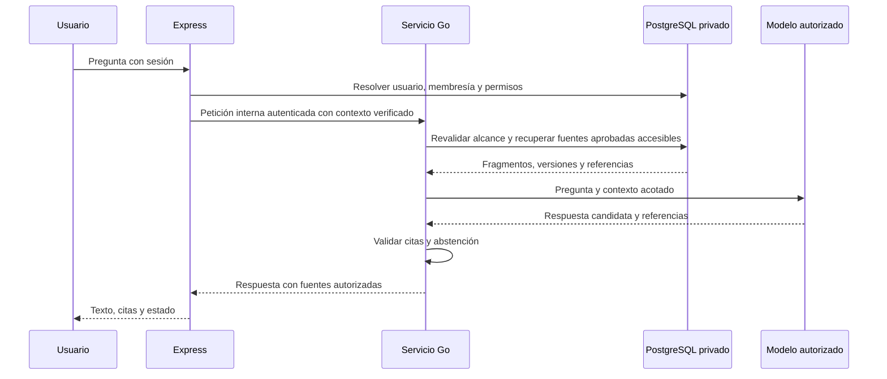
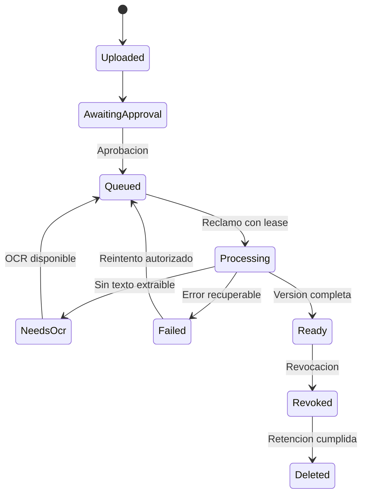

# RAG documental en Go — propuesta de integración

Estado: **no implementado** en develop ni en las ramas realtime/SaaS inspeccionadas. La página `/#rag` es explicativa. El proyecto Supabase inspeccionado no tiene extensión vector, columnas vectoriales ni tablas documentales. Groq de triaje no constituye recuperación documental ni proporciona automáticamente embeddings.

## Responsabilidad y estructura

Deimer define proveedor, política IA, contratos y evaluación. Leonardo implementa persistencia/ACL y servicio Go; Mantilla construye fuentes, ingesta y consulta; Tomas puede disparar trabajos y avisar del resultado mediante n8n. Go no escribe reservas/préstamos ni ejecuta SQL generado por un modelo.

Estructura propuesta, todavía inexistente:

```text
services/knowledge-go/
  cmd/api/                 # HTTP interno de preguntas y estado
  cmd/worker/              # reclamo durable de ingestas
  internal/access/         # membresías y permisos documentales
  internal/ingest/         # extracción, hash, chunking y límites
  internal/retrieval/      # búsqueda léxica/vectorial e identificación de citas
  internal/providers/      # interfaces de embeddings y generación
  internal/repository/     # SQL parametrizado y pool pgx
  internal/httpapi/        # contratos, deadlines y errores
  go.mod
  go.sum
```

Usar versión estable de Go fijada al implementar, `net/http`, `context`, un pool pgx y adaptador pgvector compatible. Fijar dependencias en go.mod/go.sum y revisar licencias/extracción; no elegir versiones de memoria. Context7 se consultó para Go; las APIs se deben contrastar con la versión que se instale. [Cancelación Go](https://go.dev/doc/database/cancel-operations), [transacciones Go](https://go.dev/doc/database/execute-transactions), [adaptador oficial del proyecto pgvector para Go](https://github.com/pgvector/pgvector-go).

Go ayuda a organizar IO concurrente, cancelación y trabajadores; no garantiza por sí mismo menor latencia de modelos ni mejor recuperación. No es necesario reimplementar parsers de PDF/Excel desde cero. Evaluar biblioteca mantenida o extractor aislado, sin macros/formulas ejecutables y sin introducir Python como backend alternativo por defecto.

## Flujo y límites de confianza



Express elimina cualquier actor/rol/organización enviado por el navegador. La petición interna requiere autenticación de servicio y contexto firmado de corta duración o canal autenticado equivalente, con audience y protección de replay. Go revalida membresía/ACL actuales en BD, no concede acceso solo por confiar en cabeceras. Configurar timeout, rotación y scopes separados para query/worker; no exponer servicio directamente al navegador.

Filtrar por organización, aprobación, versión activa y ACL **antes de entregar contexto al modelo** y dentro de la consulta de recuperación. Si no puede demostrarse el filtro, devolver error. El rol Go no lee auditoría global, otras tablas de dominio ni documentos no concedidos. La guía [RAG con permisos de Supabase](https://supabase.com/docs/guides/ai/rag-with-permissions) sirve como referencia; adaptar al acceso SQL de servidor del proyecto, sin asumir JWT de usuario en Prisma/pgx.

## Ingesta durable

1. API valida permiso de carga, tipo por contenido, tamaño y metadatos; guarda archivo privado y versión con hash, fuente, permiso, aprobación e `isDemo`. Carga y aprobación son capacidades separadas.
2. Crear `IngestionJob` con clave única `(documentVersionId,pipelineVersion)`. Nunca indexar un archivo directamente desde una petición larga del navegador.
3. Worker Go reclama trabajo con lease. Extrae PDF textual por página; Excel por hoja/rango preservando valores y advertencias. Escaneados pasan a `NEEDS_OCR` hasta contar con proveedor autorizado. Limitar descompresión, páginas/hojas/celdas, CPU, memoria y tiempo; no ejecutar fórmulas o enlaces externos.
4. Fragmentar con referencia estable y presupuesto por tokens; conservar página/hoja/fila, idioma y versión. Unidades de tabla deben retener encabezados. Texto extraído se trata como datos no confiables.
5. Generar embeddings en lotes con concurrencia acotada y timeout. Persistir modelo, dimensión y versión de pipeline. No mezclar vectores de modelos distintos aunque tengan la misma dimensión.
6. Publicar índice únicamente tras terminar la versión completa y comprobar aprobación vigente. Fallo o cancelación conserva diagnóstico recuperable; no publica chunks parciales.
7. Reemplazo: construir versión nueva y cambiar puntero activo de forma atómica; revocación excluye inmediatamente de consulta, invalida caché y agenda borrado de vectores/archivo según retención.



## Datos propuestos

| Entidad | Campos mínimos |
|---|---|
| KnowledgeDocument | id, organizationId, ownerId, title, source, classification, isDemo, activeVersionId, revokedAt |
| DocumentVersion | id, documentId, version, sha256, storageKey, MIME, size, approvalStatus, approvedBy, approvedAt |
| DocumentChunk | id, versionId, ordinal, text, page/worksheet/range, embedding, embeddingModel, pipelineVersion |
| DocumentGrant | documentId, principalType, principalId, permission; principal institucional validado |
| IngestionJob | versionId, status, attempts, nextAttemptAt, leaseOwner, leaseExpiresAt, errorCode, pipelineVersion |
| KnowledgeQueryEvent | actorId, organizationId, requestId, versiones citadas, outcome, duración/uso; pregunta completa solo si política lo autoriza |

La dimensión `vector(n)` se decide después de seleccionar embeddings. Empezar con recuperación exacta sobre corpus pequeño; medir recall/latencia antes de HNSW. Para índices aproximados verificar que los filtros de acceso no reduzcan excesivamente los resultados y que jamás se eliminen para mejorar recall. Añadir búsqueda léxica y fusión híbrida si la evaluación de códigos/siglas lo justifica.

## Contratos propuestos — no disponibles hoy

| Ruta pública Express | Permiso y resultado |
|---|---|
| `POST /api/knowledge/documents` | Cargador autorizado; 202 con documentId/versionId/jobId |
| `POST /api/knowledge/documents/:id/approve` | Aprobador; deja evento auditado y trabajo pendiente |
| `GET /api/knowledge/jobs/:id` | Propietario autorizado u operador con ámbito; sin texto de fuentes privadas ajenas |
| `POST /api/knowledge/query` | Sesión y lectura documental; body `{question}` con límites |
| `POST /api/knowledge/documents/:id/revoke` | Administrador autorizado; excluye inmediatamente de consultas |

Go interno: `POST /internal/v1/knowledge/query`, `GET /health`, `GET /ready`; ingesta mediante trabajo persistido. Respuesta consulta: `status=ANSWERED|NO_EVIDENCE|UNAVAILABLE`, `answer` opcional, `citations[]` con chunkId/documentId/versionId/title/page/worksheet/range/isDemo, requestId y fecha. Ausencia de evidencia no es error de infraestructura. Generación debe citar solo IDs recuperados; el servidor rechaza referencias inexistentes. El enlace a fuente vuelve a autorizar, no expone un bucket público.

Preguntas de disponibilidad o estado operativo continúan en herramientas deterministas de Express; si se combinan con RAG, la UI identifica cada origen y su momento. Corpus simulado se mantiene separado y toda cita muestra SIMULADO. No importar políticas oficiales desde material ficticio.

## Rendimiento y aceptación

Configurar deadlines propagados desde HTTP hasta DB/proveedor y cancelar al desconectar. Reutilizar cliente HTTP/pool; limitar goroutines, colas, conexiones y tokens por organización. Go comparte el presupuesto de conexiones descrito en architecture.md. Trabajadores reiniciables, errores tipados y backoff con jitter; nunca esperar un modelo dentro de una transacción SQL.

Primera entrega: un PDF textual autorizado → aprobación → trabajo Go → chunks/embeddings persistidos → pregunta desde dashboard → cita que abre página correcta. Repetir con dos usuarios de permisos distintos, revocación durante consulta, fuente maliciosa que ordena ignorar permisos, pregunta sin respuesta, fallo del proveedor y caída del worker. Después Excel con cita de hoja/rango y OCR.

Evaluación con preguntas anotadas por el equipo: fidelidad y corrección de citas, abstención, precisión de recuperación, latencia/coste y cero fugas entre organizaciones. Usar dobles en unitarias y una ejecución real marcada aparte. `go test ./...`, `go test -race ./...`, integración PostgreSQL/pgvector aislada, contrato Express-Go y E2E por rol. Solo retirar «en preparación» al aprobar el recorrido real.
