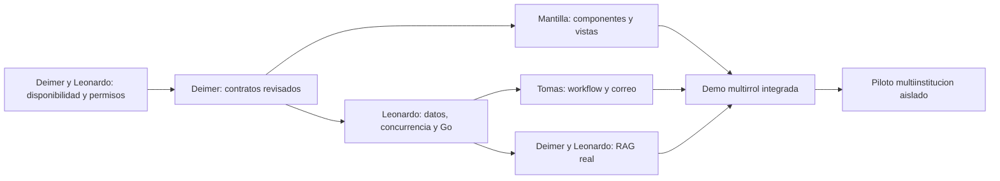

# Reparto de trabajo e integración

Plan propuesto por el usuario el 23 octubre 2026. **No se enviaron mensajes ni se asignaron issues a los compañeros.** Los IDs de esta tabla son etiquetas del plan, no issues GitHub existentes. Crear issue real antes de usar su número en una rama `feature/<issue>-<tema>`.

Leer primero [estado actual](current-state.md), [arquitectura](architecture.md) y AGENTS.md. Cada integrante entrega PR a develop con prueba, documentación y evidencia; Deimer coordina contratos/lockfile y otra persona revisa. No integrar las ramas SaaS/realtime completas por su nombre ni reasignar cambios ajenos.

## Dependencias y propiedad

## Leonardo — integración, datos y servicio documental

| ID / prioridad | Entrega concreta | Archivos/frontera | Aceptación |
|---|---|---|---|
| L1 / P0 | Inventario de drift realtime y propuesta de reconciliación | Prisma, SQL y metadatos Supabase | Comparación completa de tablas/enum/grants/índices vs migración 22180000; migraciones desde cero en BD aislada; sin reset compartido |
| L2 / P0 | Corregir alcance por permisos junto con Deimer | app.ts, operations.ts, evidence.ts, políticas compartidas | Roles por área y desconocidos no leen terceros por defecto; matriz HTTP de propietario/operador/admin; regresión de mutaciones |
| L3 / P1 | Integrar transporte realtime a partir de rama revisada | realtime/*, index.ts/app.ts, hook y contrato | Resolver CI quality; permisos de canal/URGENT, límites, revalidación, reconexión y compatibilidad entrypoint/rewrite; prueba real con dos usuarios |
| L4 / P1 | Paginación y resumen servidor | API, OpenAPI y adaptadores web; coordinación con Mantilla | Cursor estable, filtros con permisos, totales/rango/alcance y >50 registros sin omisiones/duplicados |
| L5 / P1 | Idempotencia, outbox y entregas | Migraciones + servicios transaccionales | Reintentos de creación no duplican; rollback no emite evento; dos workers y caída tras commit recuperan trabajo |
| L6 / P1 | Storage privado y mapeo persistido del plano | evidence.ts, tablas/Storage, endpoint de ubicación | Lectura autorizada, migración compatible del JSON; coordenadas validadas y versionadas; ninguna ubicación inventada |
| L7 / P2 | Servicio/worker Go de RAG | services/knowledge-go propuesto y esquema compartido | PDF aprobado → índice → consulta con cita real; sin fuga/revocado; contrato y `go test -race` |
| L8 / P3 | Aislamiento de organizaciones y sedes | M4/M5 del plan de migraciones | Cada ruta, trabajo, cache, archivo, canal y consulta RAG aislados; FKs evitan relaciones cruzadas |

Leonardo mantiene wiring frontend y datos; Mantilla es dueño de las superficies y componentes. Coordinar cambios de Workspace, workspace-shared y shell mediante PR pequeño; no duplicar componentes. Separar la incorporación realtime de la expansión SaaS y recuperar el arreglo 7f3154e sin borrar trabajo integrado.

## Samuel Mantilla — diseño, dashboard y accesibilidad

| ID / prioridad | Entrega concreta | Dependencia | Aceptación |
|---|---|---|---|
| S1 / P1 | Tokens semánticos y componentes comunes de dashboard | UI actual, product-design.md y maqueta | Mantener dirección visual; estados/foco/teclado y contraste revisados, sin librerías sin uso |
| S2 / P1 | Inicio por capacidades con cola y alcance de datos | L4/contrato; puede diseñar con fixtures PRUEBA mientras llega | Totales reales del servidor; errores parciales no parecen cero; navegación por permisos recibidos |
| S3 / P1 | Tablas/filtros/paginación y detalle consistente | L4 | Búsqueda servidor, estado en URL donde aporte, móvil y foco conservado; conflicto 409 recuperable |
| S4 / P1 | Centro de avisos y estado de comunicaciones | L3/L5, T2 | Desconectado/reconectando, pendiente/aceptado/entregado/rebotado; reintentar aviso no repite reserva |
| S5 / P2 | Biblioteca, trabajos y preguntas con citas | Contrato RAG Go y L7 | Citas abren versión autorizada; sin evidencia/fallo distintos; fuentes SIMULADAS rotuladas |
| S6 / P2 | Plano útil y panel de métricas | L6 y datos validados | Lista accesible equivalente, sin coordenadas/ocupación inventadas; periodo, fuente y tabla por gráfica |

Validación: Playwright Test desktop/móvil con fixtures marcados y recorrido integrado aparte; Playwright CLI para inspección; 360/390/768/1024/1440, teclado, reflujo y reduced motion. Medir bundle y experiencia antes/después. La UI no concede roles ni sustituye comprobaciones del servidor.

## Tomas — módulo 1, n8n y correos

| ID / prioridad | Entrega concreta | Dependencia | Aceptación |
|---|---|---|---|
| T1 / P0 | Acreditar instancia, workflow y contrato de propuesta | Instancia 5678 saludable; HTTPS alcanzable desde API | Workflow activo, credenciales por canal seguro, propuesta válida y errores con requestId; health no cuenta como prueba completa |
| T2 / P1 | Consumo de outbox y notificaciones por correo | L5 + identidad técnica de Deimer; email-n8n.md | Solo commit confirmado, deduplicación, callback autenticado, caída/reintento y entrega firmada; no duplicar email.ts |
| T3 / P1 | Revalidar aplicación de agenda y emitir eventos atómicos | Módulo 1 actual y contrato de servidor | Aforo/estado/solapes al aplicar, extensión no desplaza reserva, auditoría/outbox mismo commit; APPLIED se concilia |
| T4 / P2 | Recordatorios y resumen operativo | Fechas/políticas persistidas y permisos | Cancelación/cambio impide recordatorio obsoleto; zona correcta; vencimiento solo tras modelar dueAt |
| T5 / P3 | Calendario externo y automatizaciones por organización | SaaS aislado y proveedor autorizado | Empezar exportación ICS; para OAuth/sincronización, permisos mínimos y deduplicación sin sobreescribir dominio |

No activar execute, login n8n de BD, WhatsApp o envíos a terceros sin configuración y pruebas autorizadas. No mandar datos privados por correo solo porque los incluya un evento. Exportar workflow sin credenciales; conservar Groq principal/Gemini respaldo y protecciones de propuesta existentes.

## Deimer — integración, seguridad e IA

| ID / prioridad | Entrega concreta | Aceptación |
|---|---|---|
| D1 / P0 | Diagnosticar `/ready=503` en despliegue | Causa documentada en logs sin secretos y readiness recuperada; registrar commit/entorno verificados |
| D2 / P0 | Revisar autorización, roles y exposición de credenciales de ramas | Política de mínimo privilegio con L2; rotación coordinada y retirada de accesos compartidos; revisión de exposición histórica |
| D3 / P1 | Contratos OpenAPI, servicios internos y webhook Resend | Request/response y errores validados; identidad técnica/scopes; firma sobre raw body y replay/duplicados probados |
| D4 / P2 | Elegir embeddings/generación y evaluar RAG Go | Proveedor permitido, límites/coste, corpus autorizado y pruebas de citas/abstención/fuga; sin respuestas precargadas |
| D5 / P3 | Release/infraestructura y piloto SaaS | Presupuesto de conexiones/coste, backups restaurables, métricas y pruebas cruzadas; dependencias/lockfile coordinados |

## Integración por cortes verificables

1. D1/D2 + L1/L2: estabilizar entorno y cerrar permisos antes de ampliar usuarios. Nueva evidencia sustituye el estado observado, no lo borra.
2. D3 define contratos; S1/S2 pueden avanzar con fixtures explícitos. L4/L5 entregan base de datos/API; S3/T2 consumen contratos estables.
3. L3 y S4 incorporan comunicaciones con prueba de transporte real y aislamiento, sin mezclar SaaS incompleto.
4. D4/L7/S5 entregan un documento consultable de extremo a extremo; T2 también avisa cuando finaliza la ingesta.
5. L8/D5 prueban multiinstitución y solo entonces se habilita selector de organización, planes o portal de aliados.

Cada PR registra base/HEAD, migraciones, comandos/resultados, casos omitidos y límites externos. No basta “tests verdes”: incluir historia de usuario y efecto persistido. Revisores sugeridos: Deimer revisa datos/Go/n8n; Leonardo revisa contratos/seguridad de Deimer; Mantilla y Leonardo revisan recíprocamente la UI e integración.

## Mensajes preparados para compartir

**Leonardo:** continúa desde develop y revisa primero `docs/scaling/current-state.md`. Prioriza drift de Supabase y permisos de los roles ya existentes; después paginación/resumen, idempotencia/outbox, comunicaciones y Storage. Para RAG implementa el servicio Go según `rag-go.md`, coordinado con Deimer; evita mezclar toda la rama SaaS hasta probar aislamiento. Tus tareas detalladas son L1–L8.

**Mantilla:** trabaja la experiencia sobre el dashboard actual: componentes/tokens, inicio por capacidades, tablas paginadas, estados de correo/comunicaciones y biblioteca RAG con citas. Usa `product-design.md` y la maqueta como propuesta, conserva responsive/accesibilidad y coordina los contratos de datos con Leonardo. Tus tareas son S1–S6.

**Tomas:** conserva la responsabilidad del módulo 1/n8n. Primero acredita webhook/propuesta real y conectividad desde el servidor; después integra correo desde outbox tras commit según `email-n8n.md`. Necesitamos deduplicación, estados de entrega y reintentos, sin avisos de aplicación por propuestas ni doble envío con Resend actual. Tus tareas son T1–T5.
